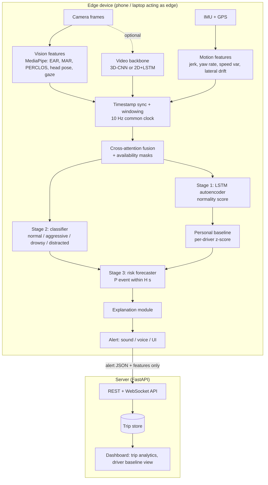

# 02. System Architecture

Status: DRAFT v0.1. Shapes and numbers here are proposals; the frozen values live in `03_data_contract.md`.

---

## 1. Design goals

| Goal | Design consequence |
|---|---|
| Stay reliable if a sensor degrades or fails | Per-modality availability masks, modality dropout in training, cross-attention that can ignore a masked stream |
| Personalized, not one global threshold | Per-driver baseline module on top of a global model, with shrinkage toward global statistics |
| Warn before danger | Separate forecaster stage predicting event onset within horizon H |
| Say why | Explanation module producing human-readable reasons from features and baseline deviations |
| Private and low latency | Raw video never leaves the device; only features and alerts are sent to the server |
| Parallel team work | Modules communicate only through the formats in `03_data_contract.md` |

---

## 2. Logical architecture

In development the "edge" is a laptop with a webcam and a phone streaming IMU. The same code path is exported to ONNX for the on-device benchmark (P5).

---

## 3. Module specifications

Each module lists input, output, owner and the file where it lives.

| # | Module | Input | Output | Owner | Path |
|---|---|---|---|---|---|
| M1 | Data loaders | Raw dataset files | Per-trip parquet (`03_data_contract.md`) | A (DMD), B (UAH), D (own) | `data/` |
| M2 | Sync + windowing | Per-trip parquet | Windows `[T, D]` + masks | B | `data/` |
| M3 | Vision features | Video frames | `X_v [T, Dv]`, `m_v [T]` | A | `features/vision.py` |
| M4 | Motion features | IMU + GPS | `X_m [T, Dm]`, `m_m [T]` | B | `features/motion.py` |
| M5 | Video backbone (optional path) | Clip `[3, 16, 112, 112]` | Embedding `[Dc]` per step | A | `models/video_backbone.py` |
| M6 | Stage 1 LSTM-AE | `X_m`, `X_v` (concat) windows of normal driving | Reconstruction error `e` | B | `models/lstm_autoencoder.py` |
| M7 | Cross-attention fusion | `X_v`, `X_m`, `m_v`, `m_m` | Fused embedding `z [Dz]` | C | `models/fusion.py` |
| M8 | Classifier head | `z` | Class logits `[K]` | C | `models/fusion.py` |
| M9 | Personal baseline | `e` or `z`, `driver_id`, history | Personalized score `s_d` | C | `personalization/` |
| M10 | Risk forecaster | Sequence of `z`, `s_d`, context | `p_risk(t, H)` for each horizon | C | `models/forecaster.py` |
| M11 | Explanation | Features, `s_d`, attention, baseline | Reason object | C | `explain/` |
| M12 | Inference engine | Live streams | Alerts at <= 1 Hz | D (+C) | `inference/` |
| M13 | API + dashboard | Alert JSON, feature summaries | Web UI | D | `serving/`, `dashboard/` |

---

## 4. Model details

### 4.1 Vision path (two options, compared in ablation)

| Option | Description | Output per 1 s step |
|---|---|---|
| V-feat (default) | MediaPipe face landmarks -> EAR, MAR, PERCLOS (rolling), head yaw/pitch/roll, gaze proxies, face-visible flag | `Dv` features |
| V-3D | 3D-CNN on 16-frame 112x112 clips, pretrained init if available, fine-tuned | `Dc`-dim embedding |
| V-2D+LSTM | 2D CNN per frame then LSTM over time (baseline for V-3D) | `Dc`-dim embedding |

The fusion network consumes a vision sequence regardless of option. For V-3D and V-2D+LSTM the embedding is concatenated with or replaces V-feat. ADR-0004 explains why 3D-CNN is a candidate rather than a commitment.

### 4.2 Motion path

IMU resampled to the common clock, gravity-aligned, filtered. GPS speed and heading rate added. Features listed in `03_data_contract.md` section 4.

### 4.3 Cross-attention fusion (M7)

Inputs: `X_v [B,T,Dv]`, `X_m [B,T,Dm]`, masks `m_v`, `m_m` (True = available).

1. Project each stream to `d_model` with a linear layer + positional encoding.
2. Learned **missing tokens** replace masked timesteps of a stream.
3. Two cross-attention blocks:
   - motion queries, vision keys/values: "what visual evidence explains this motion?"
   - vision queries, motion keys/values: "what motion evidence supports this visual cue?"
4. Key-padding masks make attention ignore unavailable timesteps.
5. A learned **gate** per stream weights the two attended outputs before pooling, so a degraded stream can be down-weighted.
6. Temporal pooling (attention pooling) gives the window embedding `z`.

Training: **modality dropout** (default p = 0.15 per modality per sample, never dropping both) so that the network learns to work with either one.

Baselines for the ablation: camera-only, sensor-only, early concatenation, late concatenation of `z_v` and `z_m` (see `04_experiment_protocol.md`).

### 4.4 Stage 1: LSTM autoencoder (M6)

- Trained **only on normal windows** (and, for personalization, normal windows of the specific driver).
- Reconstruction error `e` = mean squared error over the window.
- Used as an unsupervised abnormality signal and as an input to the forecaster. It also gives a way to flag abnormal types not in the label set.
- Design question to settle in P2: AE on raw feature windows, or on fused embeddings `z`. Run both, report both.

### 4.5 Stage 2: classifier (M8)

Cross-entropy (or focal loss for imbalance) over `K` classes. Class definitions: `03_data_contract.md` section 5.

### 4.6 Personal baseline (M9)

Per driver `d`, during calibration (first `K` trips or first `M` minutes of normal driving):

- Keep running mean `mu_d` and std `sigma_d` of Stage 1 error `e` (and optionally per-feature means).
- **Shrinkage:** `mu_hat = (n * mu_d + n0 * mu_g) / (n + n0)` where `mu_g` is the global statistic and `n0` is a prior strength (default 20 windows). Same for `sigma`.
- Personalized score `s_d = (e - mu_hat) / sigma_hat`.
- Cold start (`n` small): the result is close to the global model, so the system degrades to the non-personal version rather than failing.
- Drift handling: slow exponential update after calibration, frozen while an alert is active so abnormal behavior does not become the new normal.

### 4.7 Stage 3: risk forecaster (M10)

- Target: `y_H(t) = 1` if an abnormal event starts in `(t, t + H]`, for `H` in {2, 3, 5} seconds.
- Input: last `L` seconds of fused embeddings `z`, personalized score `s_d`, context (speed bucket, time since last alert).
- Model: small GRU or temporal conv head, one output per horizon.
- Alerting rule: raise alert when `p_risk > tau_H` for `m` consecutive steps (debounce); `tau` chosen on validation data to meet a false-alarm-per-hour budget.
- Metrics: lead time, false alarms/hour, PR-AUC (`04_experiment_protocol.md`).

### 4.8 Explanation module (M11)

Hybrid, so it is cheap enough for the edge:

1. Pick the abnormal signal type from the classifier and the largest personalized feature deviations (z-scores against the driver's baseline).
2. Check which modality contributed more (gate values, attention mass).
3. Fill a template, for example: "Eyes closed 38% of the last minute (your usual: 6%). Camera is the main source."
4. Attach the structured evidence so the dashboard can chart it.

Template strings are listed in `05_api_contract.md`. Optional extension: integrated gradients for offline analysis, not for real-time use.

---

## 5. Latency budget (target, to be measured in P5)

| Stage | Budget |
|---|---|
| Frame capture + MediaPipe | <= 40 ms per frame at 15 fps |
| Motion features | <= 5 ms per step |
| Fusion + heads | <= 30 ms per 1 s step on CPU |
| Explanation + alert | <= 10 ms |
| End-to-end alert latency | <= 300 ms after the triggering window ends |

If the 3D-CNN path misses the budget on target hardware, V-feat remains the deployed vision path and 3D-CNN is reported as an offline result.

---

## 6. Failure modes and behaviour

| Condition | Detection | System behaviour |
|---|---|---|
| Face not visible / low confidence | `face_visible = 0` or landmark confidence < threshold | `m_v = False`, fusion falls back to motion, alert metadata says `modalities_used = ["motion"]` |
| IMU dropout or phone moved | Sample gaps, orientation jump | `m_m = False`, vision-only mode, motion calibration re-run |
| GPS lost | No fix | Speed from IMU integration is unreliable; speed-dependent context features set to missing, context-aware scoring disabled |
| Low light | Face detector confidence drops | Same as face not visible; optionally IR camera later |
| Cold-start driver | Fewer than `n_min` calibration windows | Use global thresholds, show "calibrating" in UI |
| Both streams lost | Both masks False | No alerts, status "degraded", log event |

---

## 7. Privacy and security

- Raw video stays on device by default. Only feature vectors, alert JSON and trip summaries are uploaded.
- Driver identifiers are random IDs; no names or faces in the server database.
- Own recordings follow consent and retention rules in `06_data_collection_protocol.md`.
- API auth: simple token for the demo; real deployment would need proper authentication (Future Scope).

---

## 8. Technology choices

| Layer | Choice | Why | Alternative |
|---|---|---|---|
| Deep learning | PyTorch | Team skill, flexible research code | TensorFlow |
| Face features | MediaPipe Face Landmarker | Runs on CPU/mobile, gives landmarks and head pose | Dlib, OpenFace |
| Edge export | ONNX (then ONNX Runtime or TFLite conversion) | Portable | TorchScript |
| API | FastAPI + WebSocket | Async, typed schemas via Pydantic | Flask |
| Dashboard | Simple web UI (React or plain HTML + chart library) | Team skill | Streamlit for a quick first version |
| Tracking | CSV + optional MLflow or Weights & Biases | Reproducibility | |
| Data format | Parquet per trip + manifest CSV | Fast, typed | CSV |
