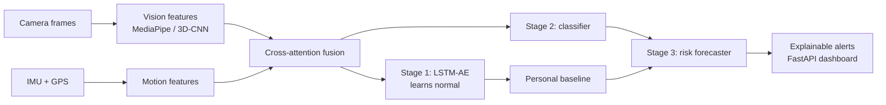

# Personalized Driver Behavior Monitoring and Early Risk Prediction using 3D-CNN and Cross-Attention Multi-Sensor Fusion

BTech Final Year Major Project (CSE), PVPIT, batch 2023-2027
Project Guide: Mrs. Urmila V. Patil

| Member | Roll No. | Workstream |
|---|---|---|
| Anuja Naik | 4036 | A. Vision pipeline |
| Tanishq Basagare | 4026 | B. Motion pipeline |
| Maruf Nadaf | 4031 | C. Fusion, personalization, forecasting |
| Gautam Iyengar | 4020 | D. Platform and delivery |

> Status: **Phase 0 (Foundations)**. Documentation first, code second. See `docs/00_PROJECT_PLAN.md`.

---

## What this project does

A driver-monitoring system that fuses in-cabin camera video with smartphone IMU and GPS data to detect abnormal driving (aggressive acceleration, sudden braking, lane weaving, micro-sleep, distraction), learn each driver's own "normal", and warn seconds before behavior becomes dangerous.

## Three innovation pillars

1. **Cross-attention fusion** that stays reliable when one sensor degrades or fails (trained with modality dropout, compared against simple concatenation).
2. **Personalized per-driver baseline**: alerts are based on deviation from the driver's own normal, not one fixed global threshold.
3. **Predictive risk engine** with **explainable alerts**: warns ahead of time and says why.

## Pipeline at a glance



Details: `docs/02_architecture.md`.

## Repository layout

See `docs/00_PROJECT_PLAN.md` section 2 for the full tree. Top level:

```
configs/   data/   dashboard/   docs/   experiments/   notebooks/
scripts/   src/driverisk/   tests/
```

## Documentation index

| Doc | Purpose |
|---|---|
| `docs/00_PROJECT_PLAN.md` | Structure, phases, priorities, team split |
| `docs/01_literature_notes.md` | The 11 references and how each supports the project |
| `docs/02_architecture.md` | Modules, data flow, models, edge vs server |
| `docs/03_data_contract.md` | Frozen feature schema, shapes, labels (read before coding) |
| `docs/04_experiment_protocol.md` | Splits, metrics, ablations |
| `docs/05_api_contract.md` | FastAPI endpoints and alert JSON |
| `docs/06_data_collection_protocol.md` | How we record our own trips, consent and safety |
| `docs/07_phase_task_breakdown.md` | Per-phase, per-person task list |
| `docs/08_team_workflow.md` | Roles, rituals, definition of done |
| `docs/09_risk_register.md` | Risks and mitigations |
| `docs/10_glossary.md` | Terms and abbreviations |
| `docs/decisions/` | Architecture decision records (ADRs) |
| `docs/reports/README.md` | Outlines for synopsis, mid-term and final report |
| `CONTRIBUTING.md` | Git workflow, code style, PR rules |

## Quickstart (will work after Phase 0 scaffold)

```bash
git clone <repo-url> && cd driver-risk-fusion
make setup          # create env, install deps, pre-commit hooks
make test           # run unit tests on stub fixtures
make demo-stub      # run the stub pipeline end to end
```

## Datasets

UAH-DriveSet, DMD (Driver Monitoring Dataset) and our own recordings. Data is never committed to git. See `data/README.md` (to be created in P0) for download steps.

## License

To be decided by the team (see ADR-0001). Dataset licenses are separate and must be respected.
